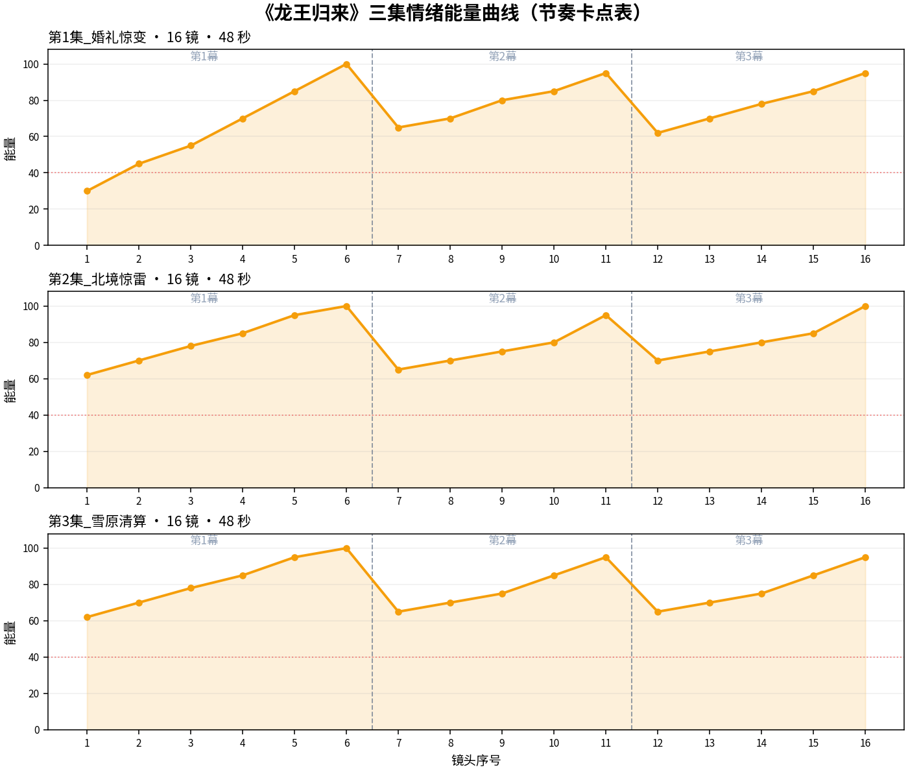
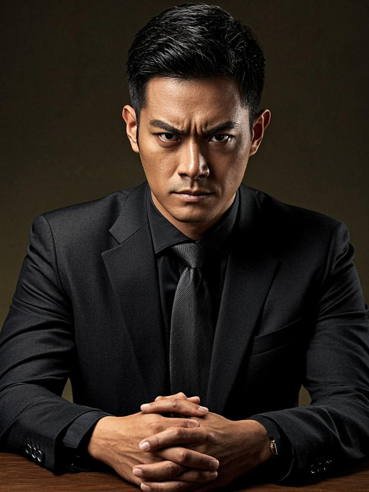
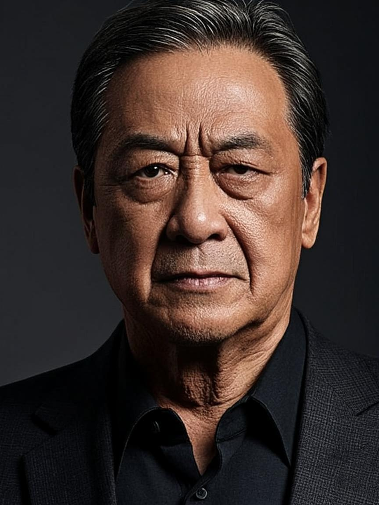
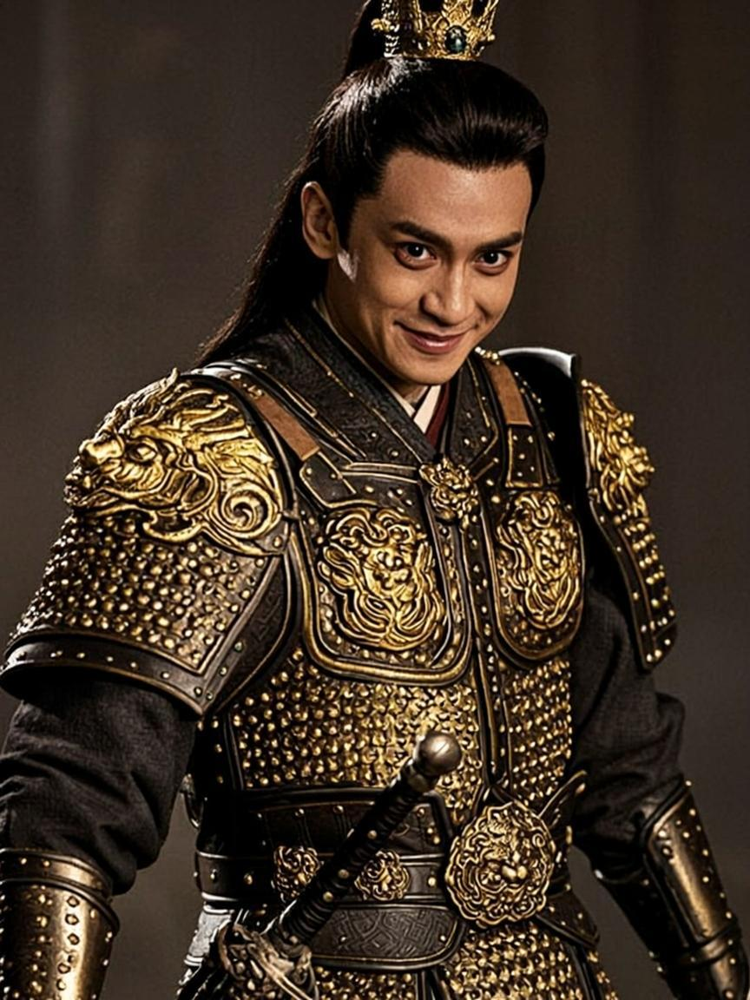

# 《龙王归来》AI 剧组流水线 · 系列效果报告

> 题材：战神逆袭（高燃打脸）｜ 系列 3 集 ｜ 每集三幕 × 16 镜头 × ~48 秒 ｜ 竖屏 9:16 720p
> 产出：真实 LLM 流水线（编剧→选角→导演→场记→后期五阶段）+ 真实图像通道定妆 65 张 + 镜头级英文提示词 48 条

## 一、系列总览

| 集数 | 剧名 | 幕 | 镜头 | 时长 | 资产 | 定妆图 | 最终提示词 | 字幕/音效/配乐轨 |
| --- | --- | --- | --- | --- | --- | --- | --- | --- |
| 第1集 | 婚礼惊变 | 3 | 16 | 48s | 15 | 15/15 | 16 | 3/16/3 |
| 第2集 | 北境惊雷 | 3 | 16 | 48s | 21 | 21/21 | 16 | 3/16/3 |
| 第3集 | 雪原清算 | 3 | 16 | 48s | 29 | 29/29 | 16 | 4/16/3 |

**资产克隆继承链**：第 1 集 15 项 → 第 2 集 21 项（继承 15 + 新角色赵擎等 6）→ 第 3 集 29 项（继承 21 + 影卫等 8）。定妆图随克隆跨集引用——同一角色三集同一张脸。

## 二、三集剧情梗概（LLM 编剧组产出）

### 第 1 集 · 婚礼惊变

> 赘婿叶凡在婚礼上被岳家当众羞辱，一纸一块钱离婚协议摔在他脸上，宾客哄笑；当夜战神令出，五大战区统领齐聚别墅门外跪地齐呼龙王，岳父吓得瘫倒在地。叶凡正要搂住妻子苏晚，加密手机骤响：北境出事了。

- **第1幕 · 第一幕：极致冲突 (黄金开头 Hook)**（hook）：豪华婚礼现场，岳父将一纸一块钱离婚协议狠狠摔在叶凡脸上，宾客哄笑，叶凡眼神冰冷，袖口龙形纹章若隐若现…
- **第2幕 · 第二幕：身份揭晓 (绝地反转 Clash)**（climax）：深夜别墅外，五大战区统领齐刷刷跪地，手持战神令齐呼龙王，岳父吓得瘫倒在地，叶凡冷眼旁观…
- **第3幕 · 第三幕：致命悬念 (卡点留钩 Cliffhanger)**（cliffhanger）：叶凡刚伸手搂住妻子苏晚，加密手机突然震动，显示北境紧急消息，叶凡表情瞬间凝重…

### 第 2 集 · 北境惊雷

> 叶凡连夜飞赴北境，发现袭击军资车队的主谋竟是当年把他推下悬崖的师兄赵擎。雪原对峙，赵擎亮出禁卫军符狂笑：这次没人救得了你。叶凡平静抬手，雪山之巅忽然浮现黑影军团轮廓。

- **第1幕 · 第一幕：极致冲突 (黄金开头 Hook)**（hook）：叶凡在暴风雪中撕毁婚书，碎片纷飞，赵擎手持长剑冷笑，叶凡脖颈处的战神项链若隐若现，眼神冰冷如刀…
- **第2幕 · 第二幕：身份揭晓 (绝地反转 Clash)**（climax）：赵擎亮出禁卫军符狂笑，叶凡平静抬手，雪山之巅黑影军团轮廓显现，禁卫军符在叶凡掌心化为灰烬…
- **第3幕 · 第三幕：致命悬念 (卡点留钩 Cliffhanger)**（cliffhanger）：叶凡战甲浮现，黑影军团单膝跪地，赵擎震惊后退，叶凡身后战旗猎猎，风雪中传来神秘低语…

### 第 3 集 · 雪原清算

> 黑影军团正是叶凡暗中训练五年的影卫，雪原决战一触即发。赵擎的禁卫军临阵反水跪降，他孤身跪在雪地里求饶。叶凡携苏晚返京，机场被记者围堵追问真实身份，他搂住妻子微笑：我只是个上门女婿。远处黑色轿车里，一双眼睛死死盯住了他们。

- **第1幕 · 第一幕：极致冲突 (黄金开头 Hook)**（hook）：雪地中央，叶凡撕碎赵擎的婚书，禁卫军跪倒一片，他脖颈上暗影军团徽章若隐若现，眼神如刀。…
- **第2幕 · 第二幕：身份揭晓 (绝地反转 Clash)**（climax）：叶凡抬手示意，黑色军团从四面八方涌出，禁卫军齐刷刷拔剑指向赵擎，雪原一片肃杀。…
- **第3幕 · 第三幕：致命悬念 (卡点留钩 Cliffhanger)**（cliffhanger）：机场通道，叶凡搂着苏晚微笑面对记者闪光灯，远处黑色轿车内，一只眼睛透过车窗死死盯着他们。…

## 三、镜头节选（导演组拆镜 + 场记锚定产物）

### 第 1 集 · 首尾镜头

| # | 镜头 | 景别 | 运镜 | 画面 | 能量 | 音效 | 台词/金句 |
| --- | --- | --- | --- | --- | --- | --- | --- |
| 1 | 婚宴大厅全景 | 全景 | static_close | 豪华婚礼现场，水晶吊灯光芒四射，宾客衣香鬓影，岳父站在中央，满脸傲慢 | 30 | 宴会背景音 | — |
| 2 | 离婚协议特写 | 特写 | push | 岳父手中一纸一块钱离婚协议被狠狠摔出，纸面一角印着侮辱性条款，背景模糊 | 45 | 纸张甩击 | — |
| 9 | 统领 · 齐声呼喊 | 中景 | pan_horizontal | 五大战区统领同时抬头，眼神坚定，齐声高呼，声音穿透夜空 | 80 | 雷鸣呼喊 | 龙王令出，谁敢不从 |
| 15 | 叶凡变脸 | 近景 | top_down | 叶凡抬头，眼神从温柔变为冰冷锐利，眉头紧锁，嘴角微微下撇，周围光线变暗 | 85 | 心跳加速 | — |
| 16 | 北境有变 | 大特写 | dolly_zoom | 叶凡面部特写，瞳孔收缩，额头微汗，手机屏幕'北境，有变'四个字在黑暗中格 | 95 | 心跳骤停 | 北境，有变 |

### 第 2 集 · 首尾镜头

| # | 镜头 | 景别 | 运镜 | 画面 | 能量 | 音效 | 台词/金句 |
| --- | --- | --- | --- | --- | --- | --- | --- |
| 1 | 雪原 · 婚书撕裂 | 特写 | dutch_tilt | 暴风雪中，叶凡双手猛力撕碎婚书，纸片如雪花般飞舞，金饰在冷蓝光线下闪烁 | 62 | 纸张撕裂 | — |
| 2 | 剑锋 · 冷笑威胁 | 大特写 | push | 赵擎手持长剑逼近，嘴角上扬露出冷笑，剑尖在风中微微颤动 | 70 | 剑风呼啸 | — |
| 9 | 手掌 · 抬起 | 全景 | pull | 叶凡缓缓抬起手掌，黑影在身后雪山之巅若隐若现，赵擎被阴影笼罩，后退一步 | 75 | 风声骤变 | — |
| 15 | 赵擎震惊 | 中景 | top_down | 俯瞰中景，赵擎震惊后退，手中禁卫军符掉落雪中，表情从狂妄转为恐惧，风雪吹 | 85 | 武器落地 | — |
| 16 | 战神归来 | 近景 | dolly_zoom | 慢动作近景，叶凡身后战旗猎猎，风雪中传来神秘低语，战神项链光芒四射，字幕 | 100 | 低语回响 | 战神归来 |

### 第 3 集 · 首尾镜头

| # | 镜头 | 景别 | 运镜 | 画面 | 能量 | 音效 | 台词/金句 |
| --- | --- | --- | --- | --- | --- | --- | --- |
| 1 | 雪地 · 婚书撕毁 | 全景 | static_close | 暴风雪山巅，叶凡站在雪地中央，手中婚书被撕碎，碎片飘落，周围禁卫军跪倒一 | 62 | 纸张撕裂声 | — |
| 2 | 眼神 · 冰冷如刀 | 特写 | push | 叶凡眼神冰冷如刀，嘴角微扬，脖颈上暗影军团徽章若隐若现，雪地反光映照出坚 | 70 | 风雪呼啸 | — |
| 9 | 俯瞰 · 军团规模 | 远景 | top_down | 俯瞰全景，黑影军团如黑色潮水般包围整个雪原，与跪地的禁卫军形成鲜明对比。 | 75 | 金属摩擦 | — |
| 15 | 车窗反射 · 双重影像 | 近景 | top_down | 车窗反射出叶凡和苏晚的影像，与车内神秘人的脸形成双重影像，对比鲜明。 | 85 | 低音弦乐 | 我，只是个上门女婿。 |
| 16 | 神秘人 · 阴冷目光 | 特写 | top_down | 神秘人面部特写，嘴角微微上扬，眼中闪过一丝寒光，手指轻敲车窗。 | 95 | 金属摩擦声 | — |

## 四、镜头级最终提示词（可直接投喂视频基模）

**第 1 集 · 镜头 6「戒指特写收尾」**

```text
[Characters] 30-year-old Chinese male warlord, sharp jawline, short black hair, black suit with dragon cufflinks, intense gaze [Scene] luxury wedding venue, gold and black color scheme, crystal chandeliers, high contrast lighting [Props] silver ring with intricate dragon engraving, subtle glow under lighting [Action] Dragon ring catching light, metallic shine, fade to black [Camera] rapid push-in to close-up, aggressive framing [Style] high-contrast dramatic cinema, intense confrontation, low angle hero shot, cinematic lighting, gold and obsidian tones, high tension facial micro-expressions [Technical] vertical 9:16 format, 3s duration, 720p, 大特写 framing, cinematic quality
```

> 提示词由「角色锚定段 → 场景段 → 道具段 → 动作段 → 运镜段 → 影调段 → 技术段」确定性组装，角色段来自资产库冻结锚点——这是跨镜头不换脸的机制保证。

## 五、能量曲线（节奏卡点表）



三集能量曲线均呈「三幕阶梯递进」：第 1 幕钩子 30→100 拉满，第 2 幕高潮 65→95，第 3 幕悬念 62→95 收钩。红色虚线为节奏塌陷预警线（40），三集全部镜头在预警线之上。

## 六、主要角色定妆（跨集一致性）

**叶凡**（第 1 集定妆，第 1/2/3 集引用同一张图）



**岳父**（第 1 集定妆，第 1/2/3 集引用同一张图）



**苏晚**（第 1 集定妆，第 1/2/3 集引用同一张图）


**赵擎**（第 2 集定妆，第 2/3 集引用同一张图）



## 七、后期三轨（第 1 集示例）

**字幕轨（金句大字）**

| 入点 | 出点 | 金句 |
| --- | --- | --- |
| 9.0s | 12.0s | 一纸婚书，不值一提 |
| 24.0s | 27.0s | 龙王令出，谁敢不从 |
| 45.0s | 48.0s | 北境，有变 |

**音效卡点（节选）**：宴会背景音@0.0s、纸张甩击@3.0s、纸张飘落@6.0s、哄笑声起@9.0s、心跳加速@12.0s、金属碰撞@15.0s、金属碰撞声@18.0s、低沉嗡鸣@21.0s

**配乐情绪段**：重低音震荡战鼓、霸气交响乐渐强、金属拔剑音效(0s~18s)、重低音震荡战鼓、霸气交响乐渐强、金属拔剑音效(18s~33s)、重低音震荡战鼓、霸气交响乐渐强、金属拔剑音效(33s~48s)

## 八、批量生产验证

- 系列级批量提交：48 个镜头渲染任务（16×3 集）一次性入队，任务中心统一观测；
- 视频通道当前为降级模式（未接入云端视频生成），任务按设计返回明确指引「可按最终提示词在外部工具出片后回贴地址」，创作流不阻塞；
- 全部 65 张定妆图由真实图像通道生成并回写资产库；
- 断点重试实测：流水线 429 限流中断后，从失败阶段（导演拆镜）幂等续跑成功，已完成阶段零浪费。
